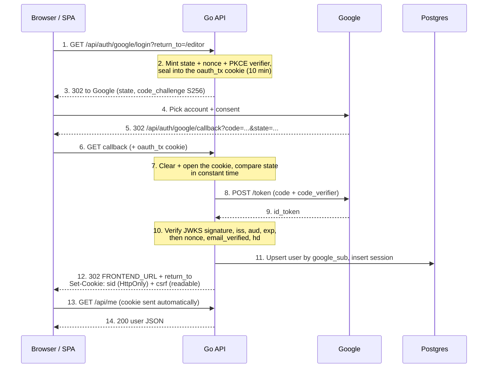
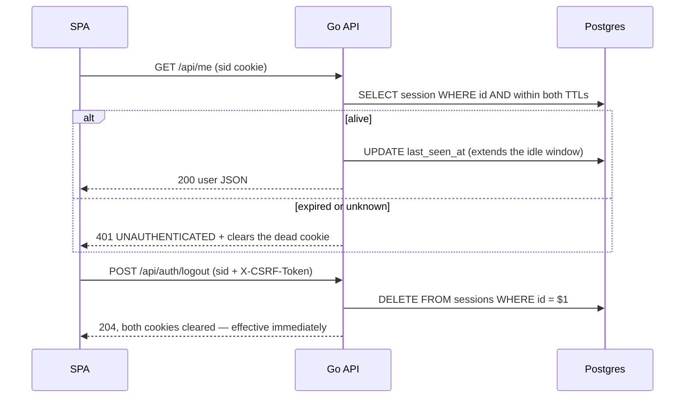

# Google Sign-in with Server-Side Sessions (Go)

> **Goal:** Users sign in / sign up with Google and stay signed in until they log out or go idle.
> **Stack:** Go, `gorilla/mux`, `golang.org/x/oauth2`, `github.com/coreos/go-oidc/v3`, Postgres (`pgx/v5`).
> **Standards:** OAuth 2.0 Authorization Code + PKCE (RFC 7636), OpenID Connect, RFC 9700 (OAuth Security BCP).
>
> **This file describes the backend as it actually is.** It replaced an earlier design based on JWT
> access tokens and rotating refresh tokens; nothing of that design remains. If you find a document
> describing `login_codes`, `refresh_tokens` or `Authorization: Bearer`, it is stale.

---

## 1. Overview

The browser goes through Google once. The callback sets an **HttpOnly session cookie** and redirects
into the SPA — there is no token handoff, no code in a URL, and nothing for the frontend to store.

- **Session**: a random 32-byte id in the `sid` cookie. The row in `sessions` *is* the session, so
  deleting it logs the user out immediately.
- **CSRF token**: a second cookie, `csrf`, deliberately readable by script. The SPA echoes it in
  `X-CSRF-Token` on every unsafe request.
- **Login transaction**: `state`, `nonce`, the PKCE verifier and `return_to`, sealed with AES-256-GCM
  into the short-lived `oauth_tx` cookie. The browser carries them but cannot **choose** them —
  integrity is the point, see §4. Nothing about an in-flight login touches the database.

A Google account whose `sub` is not in `users` is a **sign-up**; otherwise it is a **sign-in**.

### Why cookies rather than Bearer tokens

A stateless JWT cannot be revoked: logout leaves an issued token valid until it expires. A session
row costs one indexed primary-key lookup per request and buys real logout, real revocation, and no
token for the frontend to mishandle. The price is CSRF, which Bearer tokens gave us for free — hence
the double-submit middleware.

### Code layout

```
internal/auth/
  services.go          Service: StartGoogleLogin, CompleteLogin, SessionUser, Logout
  services_google.go   GoogleAuth: OIDC discovery, AuthCodeURL, Identify (verified claims)
  logintx.go           seal/open the oauth_tx payload — two functions over *secret.Box
  repositories.go      Repository: the SQL, behind an interface so the service can be faked
  handlers.go          HTTP: redirects, /me, logout, failLogin
  handlers_cookie.go   the only place cookie attributes are chosen
  middleware.go        RequireAuth: sid cookie -> user in context
  cleanup.go           daily sweep of expired sessions
  models.go            User, Session, LoginTransaction, GoogleIdentityParams
  model_services.go    LoginRedirect, CallbackInput, LoginResult (service boundary)
  model_handlers.go    UserResponse, MeResponse (the JSON shapes)
internal/secret/       AES-256-GCM Box used to seal oauth_tx (and API keys in M2)
internal/platform/middleware/csrf.go   double-submit enforcement
```

Dependencies point inward: `router → auth → platform/{db,config,handler}` and `auth → secret`.
`auth` never imports `router`. `Repository` and `IdentityProvider` are interfaces so the service is
testable without a database or Google.

The sealer is deliberately **not** an interface: `*secret.Box` is the only implementation and the
tests use the real one, so the crypto is exercised rather than stubbed. Fake it only if a test ever
needs a seal failure.

---

## 2. Sequence diagrams

### 2.1 Login (sign-in / sign-up)



### 2.2 Calling the API



---

## 3. API contract

| Method | Path | Auth | Request | Success | Errors |
|---|---|---|---|---|---|
| GET | `/api/auth/google/login` | – | `return_to` (optional, path only) | 302 to Google, sets `oauth_tx` | 302 `FRONTEND_URL/login?error=server_error` |
| GET | `/api/auth/google/callback` | `oauth_tx` cookie | `code`, `state` (from Google) | 302 `FRONTEND_URL` + `return_to`, sets `sid` + `csrf` | 302 `…/login?error=cancelled\|login_failed\|forbidden\|server_error` |
| POST | `/api/auth/logout` | `sid` + CSRF | – | 204, cookies cleared | 403 `FORBIDDEN` (CSRF) |
| GET | `/api/me` | `sid` | – | 200 `{data:{user:{id,email,name,avatarUrl}}}` | 401 `UNAUTHENTICATED` |

Errors use the shared envelope from `internal/platform/handler/error.go`:
`{"error":{"code":"UNAUTHENTICATED","message":"<Vietnamese>"}}`. Success responses are wrapped in
`config.SuccessResponse` (`session_id`, `count`, `data`).

The `?error=` values on the login redirect are a **separate, frontend-facing set** — `cancelled`,
`login_failed`, `forbidden`, `server_error` — not `handler.ErrorCode`s. The cause is logged, never
put in the URL.

**Known divergences from the root `../../CLAUDE.md` §6**, which still describes the Bearer design:
the login route is `/api/auth/google/login` (not `/api/auth/google`), there are no `/api/auth/token`
or `/api/auth/refresh` endpoints, and `/api/me` returns only `user` — `settings` and `apiKey` arrive
with the M2 tables.

---

## 4. Credential model

| | Session (`sid`) | CSRF (`csrf`) | Login transaction (`oauth_tx`) |
|---|---|---|---|
| Format | 32 random bytes, base64url | 32 random bytes, base64url | AES-256-GCM sealed JSON, ~310 bytes |
| Lifetime | `SESSION_TTL` absolute (12h) **and** `SESSION_IDLE_TTL` idle (30m) | same as the session | 10 minutes |
| Server storage | `sessions` row (id stored raw) | none | none |
| Readable by JS | no (`HttpOnly`) | **yes, by design** | no (`HttpOnly`) — encryption is a side effect, not the goal |
| Revocation | `DELETE` the row — immediate | n/a | cleared at the callback |

**Rules**
- A fresh session id every login, never a reused one — this is what defeats session fixation.
- Both TTLs are enforced **in SQL** by `GetSession`, so an expired row can never resolve to a user.
- `sessions.id` is stored raw rather than hashed: the cookie is `HttpOnly`, and a database dump
  already implies total compromise. Revisit if that stops holding.
- `ExpiresAt` inside `oauth_tx` is checked server-side, not trusted to the cookie's `Max-Age`.

### What sealing `oauth_tx` buys — and what it does not

**Integrity is the whole point.** Without the GCM tag the browser could rewrite its own cookie:
`return_to` to an absolute URL (an open redirect — `SafeReturnTo` runs at *write* time only, so it
would be bypassed entirely), or `ExpiresAt` out by a year. The tag makes those values ours.

**Confidentiality adds almost nothing**, and earlier revisions of this file oversold it. The
verifier and nonce belong to the client's *own* login; a public SPA client would hold them in
JavaScript by design. Hiding them from the user who owns them protects nobody. AES-GCM is used
because `internal/secret` already exists for M2's API keys, so authenticated encryption costs
nothing over a bare MAC — not because the plaintext is sensitive.

**It does not stop an attacker planting a blob.** Anyone can hit the login route and receive a
validly sealed cookie for their own flow; nothing in the payload binds it to a browser. Delivering
it to a victim needs a cookie-forcing vulnerability, and `__Host-` plus HTTPS are the defences.
The old `login_transactions` table had exactly the same hole — a valid transaction id in the cookie
was equally plantable — so this is not a regression from dropping it.

### Why state *and* PKCE *and* nonce

Three different jobs. `state` is checked by us (stops login CSRF, and still works when the user
cancels and no `code` comes back). The PKCE verifier is checked by **Google** during the exchange, so
a leaked or injected `code` cannot be redeemed. The `nonce` is checked inside the **ID token**, binding
that token to this login.

---

## 5. Cookies

| Cookie | Path | Lifetime | Attributes |
|---|---|---|---|
| `sid` | `/` | `SESSION_TTL` | `HttpOnly`, `Secure`*, `SameSite=Lax` |
| `csrf` | `/` | `SESSION_TTL` | `Secure`*, `SameSite=Lax` — **not** `HttpOnly` |
| `oauth_tx` | `/api/auth/google` | 10 min | `HttpOnly`, `Secure`*, `SameSite=Lax` |

\* `Secure` and the `__Host-` name prefix are added when `APP_ENV=production`. Both read the same
`secure()` call in `handlers_cookie.go`, so they can never disagree.

`SameSite=Lax`, not `Strict`: Google's redirect back to the callback is a cross-site top-level
navigation, and a `Strict` cookie would not be sent on it.

### CSRF

`internal/platform/middleware/csrf.go` compares `X-CSRF-Token` against the `csrf` cookie with
`subtle.ConstantTimeCompare` on every unsafe method, and is wired on the whole `/api` subrouter.
Safe methods (`GET`/`HEAD`/`OPTIONS`/`TRACE`) pass through, which is why the Google login routes need
no path exemption. The cookie name is passed **into** the middleware rather than imported from this
package, so `platform` keeps no dependency on a feature package.

A readable CSRF cookie is not a credential leak: it proves only that the request came from a page
able to read this origin's cookies, which a cross-site page cannot do.

---

## 6. Database

Two tables. `db/migrations/00001_auth_baseline.sql` is the whole schema.

```sql
create table users (
    id             bigserial   primary key,
    google_sub     text        unique not null,
    email          text        not null,
    email_verified boolean     not null default false,
    name           text        not null default '',
    avatar_url     text        not null default '',
    hd             text        not null default '',
    created_at     timestamptz not null default now(),
    last_login_at  timestamptz not null default now()
);

create table sessions (
    id           text        primary key,
    user_id      bigint      not null references users (id) on delete cascade,
    created_at   timestamptz not null default now(),
    last_seen_at timestamptz not null default now()
);
create index sessions_user_idx      on sessions (user_id);
create index sessions_last_seen_idx on sessions (last_seen_at);
```

| Repository method | SQL |
|---|---|
| `UpsertGoogleIdentity` | `INSERT … ON CONFLICT (google_sub) DO UPDATE … RETURNING …, (xmax = 0)` — one round trip; `xmax = 0` means this statement inserted the row, i.e. a sign-up |
| `GetUserByID` | `SELECT … WHERE id = $1` |
| `CreateSession` | `INSERT INTO sessions …` |
| `GetSession` | `SELECT … WHERE id = $1 AND created_at > $2 AND last_seen_at > $3` — both TTLs |
| `UpdateSessionLastSeenAt` | `UPDATE sessions SET last_seen_at = now()` |
| `DeleteSession` / `DeleteUserSessions` | logout one device / all devices |
| `DeleteExpiredSessions` | `DELETE … WHERE created_at <= $1 OR last_seen_at <= $2` (startup + every 24h) |

A missing row is a sentinel, not a wrapped driver error: `GetSession` returns `ErrNoSession` and
`GetUserByID` returns `ErrNoUser`, so a caller can tell "not there" from "database is down".

**A user is only ever looked up by `google_sub`, never by email.** Resolving by email would let anyone
who can obtain a Google account at a known address take over the existing account. There is no
`user_identities` table: it was a join table for a one-to-one relationship, and the protection comes
from the lookup key, not from the table split. Adding a second sign-in provider later means
re-introducing it with a backfill from `google_sub`.

---

## 7. Error handling

| Situation | Behaviour |
|---|---|
| `oauth_tx` missing, forged, tampered, foreign or expired | 302 `/login?error=login_failed` — fails closed, **no** token exchange |
| User cancels at Google | 302 `/login?error=cancelled` |
| State mismatch | 302 `/login?error=login_failed` (`ErrLoginRejected`), before contacting Google |
| Exchange failure, bad `id_token`, nonce mismatch, no `sub`, `email_verified=false` | 302 `/login?error=login_failed` |
| `hd` not the allowed Workspace domain | 302 `/login?error=forbidden` (`ErrDomainNotAllowed` — proven identity, not permitted here) |
| DB error during the callback | 302 `/login?error=server_error` |
| Missing / unknown / expired `sid` | 401 `UNAUTHENTICATED`, dead cookie cleared |
| Missing or mismatched CSRF token | 403 `FORBIDDEN` |

Log the cause on the server; never return an internal error, and never log a cookie value, sealed
blob, authorization code or ID token.

---

## 8. Frontend contract

1. "Sign in with Google" is a plain link to `GET {API}/api/auth/google/login?return_to=/editor` — a
   full-page navigation, not `fetch`. Only a path is accepted; anything else becomes `/`.
2. There is **no** callback page to write and nothing to store. The callback lands directly on
   `return_to` with the cookies already set.
3. Every request needs `credentials: 'include'` (the API may be on another origin).
4. On every unsafe request, read the `csrf` cookie and send it as `X-CSRF-Token`.
5. Page `/login` shows a message for `error=cancelled`, `login_failed`, `forbidden`, `server_error`.
6. On a 401, drop client state and route to `/login` — there is no refresh step to attempt.
7. Logout: `POST /api/auth/logout` with the CSRF header; the server clears both cookies.

---

## 9. Configuration

| Variable | Example | Notes |
|---|---|---|
| `GOOGLE_OAUTH_CLIENT_ID` / `_SECRET` | – | Required; the code exchange is server-side |
| `ENCRYPTION_KEY` | `ZXhhbXBsZS1rZXktZG8tbm90LXVzZS1pbi1wcm9kISE=` | Required. **Standard** base64 (`+/=`, not base64url) of **exactly 32 bytes** → always 44 chars ending in `=`. Generate with `openssl rand -base64 32`; the example is a placeholder, not a key |
| `ENCRYPTION_KEY_VERSION` | `1` | Integer **1–255** — it is stored as a single byte prefixed to every sealed value, which is the hook for key rotation |
| `SESSION_TTL` | `12h` | Absolute lifetime (default 12h) |
| `SESSION_IDLE_TTL` | `30m` | Idle window, must not exceed `SESSION_TTL` |
| `GOOGLE_ALLOWED_HD` | `example.com` | Empty = any Google account |
| `BASE_URL` | `http://localhost:9999` | Public API origin |
| `FRONTEND_URL` | `http://localhost:5173` | Redirect target and the only CORS origin |

`config.Load()` fails fast if the OAuth client id/secret, the redirect URL or `ENCRYPTION_KEY` is
missing, rather than 302-ing to Google with an empty client id. `NewBox` then rejects a key of the
wrong length at startup — AES-256 is pinned, so there is no weaker mode to fall back to.

⚠️ **`-base64 48` is the trap.** The deleted `JWT_SECRET` wanted ≥32 bytes of entropy and the old
docs suggested 48; copying that here fails with `key must decode to 32 bytes, got 48`. Note also that
`ENCRYPTION_KEY_VERSION` is read through `envIntOr`, which **swallows a parse error** and silently
yields `1` — harmless today, worth remembering on the day you rotate.

Google Cloud Console: Web application client, **Authorized redirect URI**
`{BASE_URL}/api/auth/google/callback`. Keep scopes non-sensitive (`openid`, `userinfo.email`,
`userinfo.profile`), keep the app in Testing with team accounts as test users, no logo during the MVP.

---

## 10. Security checklist

- [x] New random `state`, `nonce` and PKCE verifier per login
- [x] `state` compared with `subtle.ConstantTimeCompare`
- [x] `oauth_tx` integrity-protected (AES-256-GCM tag) with an AAD domain separator naming its
      context, so a blob from one context cannot be opened in another; expiry checked server-side
- [x] ID token verified against the JWKS: signature, `iss`, `aud`, `exp`, then `nonce`
- [x] `email_verified` required; users keyed by `google_sub`, never by email
- [x] No credential ever travels in a URL
- [x] Fresh session id per login (session fixation)
- [x] Session cookie `HttpOnly`; `Secure` + `__Host-` in production
- [x] Dual TTL enforced in SQL; logout deletes the row and takes effect immediately
- [x] CSRF double-submit on every unsafe `/api` method, constant-time compare
- [x] CORS allows exactly one origin, `FRONTEND_URL`
- [x] Security headers on every response; HSTS in production
- [x] No cookies, blobs, codes or tokens in logs; no internal errors in responses

---

## 11. Known trade-offs

- **Replay of the callback is not caught by us.** The old `login_transactions` table made a callback
  single-use via `DELETE … RETURNING`. With a sealed cookie we clear it, but cannot prove it was not
  kept, so a replay reaches Google — where the authorization code is already spent and the exchange
  fails. Pinned by `TestCompleteLoginReplayReachesGoogleAndFails`.
- **Neither this design nor the table it replaced resists cookie-forcing.** An attacker who can set
  the victim's `oauth_tx` can complete a login as *their own* Google account in the victim's browser
  (login CSRF). `__Host-` cookies and HTTPS are what prevent the delivery; no payload format helps.
- **A session read costs a query per authenticated request.** That read is exactly what makes logout
  and revocation work.
- `UpdateSessionLastSeenAt` writes on every authenticated request. Fine at this scale; batch or sample it if the
  write rate ever matters.
- An absolute `SESSION_TTL` of 12h means an active user is signed out once a day. Raise it, or add
  re-authentication for sensitive actions, if that becomes annoying.
- `hd` is stored on `users` but never read back; the Workspace check runs against the live claim.
